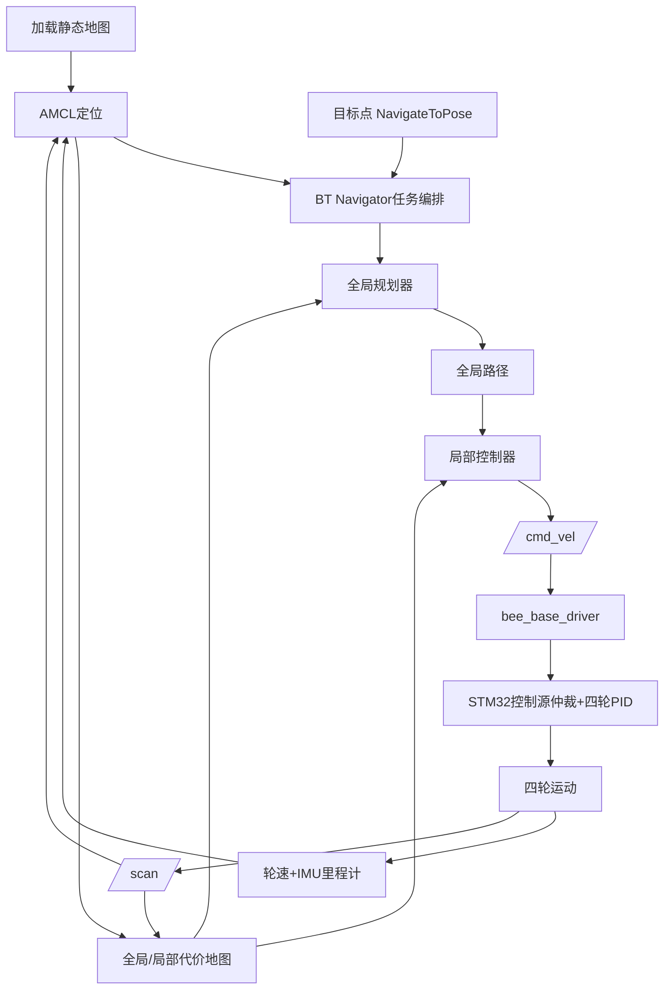

# 2026-09-23 ROS四大功能链路与基础概念

## 1. 一句话理解整车闭环

RDK X5根据雷达、轮速、IMU和地图判断“车在哪里、目标在哪里、应该怎么走”，持续输出线速度与角速度；STM32把速度目标变成四个轮子的闭环动作，并始终保留本地安全保护。

```mermaid
flowchart LR
    L[LD14激光雷达] --> S[/scan]
    E[四路编码器] --> M[STM32F103]
    I[ICM42670] --> M
    M -->|UART5遥测| B[bee_base_driver]
    B --> W[/wheel_ticks]
    B --> U[/imu/data_raw]
    W --> F[robot_localization]
    U --> F
    F --> O[/odometry/filtered]
    S --> N[SLAM或AMCL/Nav2]
    O --> N
    G[目标点/巡逻点] --> N
    N --> C[/cmd_vel]
    C --> B
    B -->|UART5连续速度| M
    M --> P[四轮PID与电机]
    P --> E
```

这是一条闭环：电机运动产生新的编码器、IMU和雷达数据，RDK重新估计位置并修正下一次速度。

## 2. 三层职责

### 感知与执行层

- LD14：测量周围障碍物距离，形成二维360度扫描。
- 四路编码器：告诉系统四个轮子实际转了多少。
- ICM42670：告诉系统加速度和转动角速度。
- 电机与驱动：真正让车辆运动。

### STM32实时层

- 读取编码器和ICM42670；
- 运行四轮速度PID；
- 执行RDK下发的连续线速度、角速度；
- 保留蓝牙、MQTT、原避障/自主模式；
- 执行急停、失联停车和本地近障保护；
- 向RDK输出带序号、CRC和采样时间戳的遥测。

### RDK X5 ROS2决策层

- 驱动LD14并发布 `/scan`；
- 通过 `bee_base_driver` 与STM32通信；
- 融合轮速和IMU；
- 建图、定位、规划路线、绕障、到点和巡逻；
- 将Nav2的 `/cmd_vel` 转换为UART5连续速度帧。

## 3. ROS2基础概念

### Node（节点）

一个完成单一职责的程序。例如雷达驱动、底盘驱动、定位、规划器都分别是节点。多个节点通过ROS2通信组成系统。

### Topic（话题）

持续广播数据的数据通道，适合传感器和速度流。例如：

- `/scan`：雷达扫描；
- `/imu/data_raw`：IMU原始数据；
- `/odometry/filtered`：融合后的里程计；
- `/cmd_vel`：期望线速度与角速度。

Topic像广播，发布者持续发送，订阅者按需接收。

### Action（动作）

适合需要较长时间完成、能够反馈进度并可取消的任务。例如：

- `/navigate_to_pose`：前往一个目标位姿；
- `/follow_waypoints`：依次前往多个航点。

Action包含目标、执行反馈和最终结果，不应误写成普通Topic。

### Service（服务）

一次请求、一次响应，适合清空代价地图、保存地图等短操作，不适合持续运动控制。

### TF（坐标变换）

TF回答“某个传感器或车体相对另一个坐标系在哪里”。本车至少需要：

```text
map -> odom -> base_link -> laser_link
                         -> imu_link
```

- `map`：全局地图坐标，定位纠正后可跳变；
- `odom`：短时间连续的里程计坐标，会慢慢漂移；
- `base_link`：车体中心；
- `laser_link`：雷达安装位置；
- `imu_link`：IMU安装位置。

TF错误会造成墙体重影、地图旋转、规划路径偏移或车辆朝反方向运动。

### 里程计、定位与SLAM的区别

- 里程计：根据轮子和IMU估计“刚才移动了多少”，连续但会累积漂移。
- SLAM：边走边用雷达建地图，同时估计自身位置。
- 定位：已有地图时，用AMCL将实时雷达与地图匹配，估计车辆在地图中的位置。
- 自主导航：在已经能够定位的基础上，规划并控制车辆到目标点。

## 4. 建图阶段的链路

```text
掌机蓝牙/MQTT人工驾驶
        ↓
STM32控制四轮运动
        ↓
LD14 /scan + 轮速/IMU里程计 + TF
        ↓
slam_toolbox
        ↓
实时地图 /map + 车辆地图位姿
        ↓
保存地图图像与yaml配置
```

建图时建议由人低速遥控，确保路线覆盖充分并完成闭环。SLAM不是日常导航必须一直运行的唯一方式；地图保存后，正式导航通常加载地图并用AMCL定位。

## 5. 导航阶段的完整闭环



## 6. 四项ROS功能分别怎样实现

### 6.1 自主导航

含义：用户指定地图中的目标位置和朝向，车辆自己到达。

实现链路：

1. 地图服务器加载已保存地图；
2. AMCL结合 `/scan`、里程计和地图得到当前位置；
3. 用户或掌机向 `NavigateToPose` Action发送目标；
4. Nav2行为树组织规划、跟踪、恢复和到点判定；
5. 控制器持续输出 `/cmd_vel`；
6. `bee_base_driver`封装UART5帧；
7. STM32将线速度、角速度换算为左右轮目标并执行四轮PID；
8. 编码器、IMU和雷达反馈使导航不断修正。

自主导航不是一个单独算法，而是定位、规划、避障、速度控制和安全保护共同组成的闭环。

### 6.2 导航避障

含义：车辆导航途中发现新障碍物后减速、停车、绕开或重新规划。

两层保护：

- ROS层避障：LD14数据进入局部代价地图，局部控制器选择无碰撞速度；障碍长期挡路时重新计算全局路径或执行恢复行为。
- STM32安全层：本地近障、急停和失联保护具有更高优先级，即使RDK异常也能停车。

导航避障不等于只检测前方距离后转弯。Nav2需要机器人轮廓、障碍层、膨胀层、雷达范围、速度/加速度限制等参数共同工作。

二维LD14只能看到扫描平面的障碍，低矮台阶、悬空物体和部分玻璃仍需保险杠、防跌落或深度相机补盲。

### 6.3 路径规划

含义：从当前位置计算一条通向目标的安全路线。

- 全局规划器：在整张地图和全局代价地图上选择总体路线。
- 局部控制器：结合车附近的实时障碍、车辆运动学和全局路径，计算下一时刻的速度。
- 全局路径回答“总体从哪里走”；局部控制回答“现在这一小步怎么开”。

路径规划本身不会直接控制PWM，最终仍输出 `/cmd_vel`，由STM32完成轮速闭环。

### 6.4 定点与多航点巡逻

含义：在A、B、C等预设点之间按顺序或循环运行。

实现链路：

1. 保存多个地图坐标和朝向；
2. 巡逻任务节点调用 `FollowWaypoints`，或逐个调用 `NavigateToPose`；
3. Nav2完成当前点导航并返回反馈和结果；
4. 到点后可等待、鸣笛、拍照或上报状态；
5. 根据策略进入下一点；
6. 失败时执行重试、跳过、暂停、人工接管或返航；
7. 低电量、急停、失联等条件可中止任务。

巡逻是导航之上的任务管理层，不是另一套底盘控制算法。

## 7. 与现有蓝牙和MQTT的关系

```text
蓝牙人工控制 ─┐
MQTT人工控制 ─┼─> STM32控制权仲裁 -> 安全保护 -> 四轮PID
ROS /cmd_vel ──┘
```

- 蓝牙和MQTT仍按原方式控制，不经过Nav2也能开车；
- ROS模式下只有RDK的连续速度能够驱动底盘；
- 人工蓝牙或MQTT控制应能抢占ROS，抢占前先停车并取消Nav2任务；
- 控制源切换必须清零旧命令，避免车辆沿用上一个来源的速度；
- 原STM32自主避障模式和ROS地图导航使用不同状态码和界面名称。

## 8. 计划软件模块

| 模块 | 作用 | 主要接口 |
|---|---|---|
| LD14驱动 | 原始串口转LaserScan | `/scan` |
| `bee_base_driver` | RDK与STM32串口桥 | `/cmd_vel`、轮速、IMU、电池、状态 |
| `robot_localization` | 轮速与IMU融合 | `/odometry/filtered` |
| `slam_toolbox` | 二维建图 | `/scan`、TF、`/map` |
| `nav2_map_server` | 加载保存地图 | `/map` |
| `nav2_amcl` | 已有地图定位 | `/scan`、TF |
| `nav2_planner` | 全局路径 | 全局代价地图、路径 |
| `nav2_controller` | 局部控制与跟踪 | 局部代价地图、`/cmd_vel` |
| `nav2_bt_navigator` | 导航任务编排与恢复 | `NavigateToPose` Action |
| `nav2_waypoint_follower` | 多航点执行 | `FollowWaypoints` Action |

LD14具体驱动包名和Nav2插件型号需在RDK OS 3.5.0/Humble环境及真车参数确认后定稿，本文不把候选配置写成已验证事实。

## 9. 本轮检查点与纠正记录

- 完成时间：2026-09-23 09:56。
- 完成内容：梳理感知、定位、规划、控制和执行闭环；解释四项ROS功能与基础概念；明确与蓝牙/MQTT的关系。
- 发现问题：此前总体方案和Skill把 `/navigate_to_pose`、`/follow_waypoints` 与普通Topic并列。
- 根因：接口方向摘要没有区分连续数据流与长任务接口。
- 修正：明确两者为Nav2 Action，分别提供目标、反馈和结果；总体方案和Skill同步更正。
- 未验证边界：本轮为架构与概念说明，没有安装ROS包、启动节点或实车验证。
- 下一步：仍按阶段0冻结原蓝牙、MQTT和STM32原功能基线，然后进入正式协议设计。
- Skill校验：已运行 `quick_validate.py`，结果为 `Skill is valid!`，退出码0。
